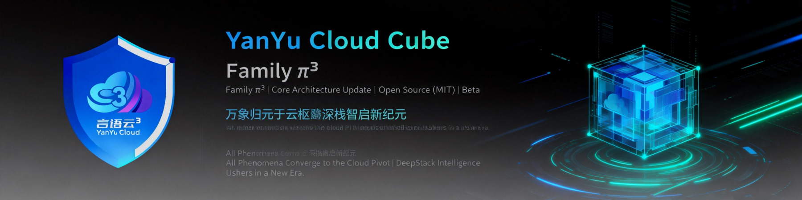

<!-- markdownlint-disable MD033 MD041 -->
<p align="center">
  
</p>
<!-- markdownlint-enable MD033 MD041 -->

<h1 align="center">YYC³ 小语智能成长守护系统（统一基线）</h1>

<p align="center">
  <a href="https://github.com/YYC-Cube/YYC3-Baby-MoYu/actions/workflows/ci.yml">
    
  </a>
  <a href="https://github.com/YYC-Cube/YYC3-Baby-MoYu/actions/workflows/deploy-pages.yml">
    
  </a>
  <a href="https://github.com/YYC-Cube/YYC3-Baby-MoYu/actions/workflows/osv-audit.yml">
    
  </a>
  
  
  
  <a href="./SECURITY.md">
    
  </a>
</p>

<p align="center">
  
  
  
  
  
  
  
</p>

<p align="center">
  
  
  
  
  
</p>

<p align="center">
  <strong>标签 / Keywords</strong><br />
  <code>#Next.js</code> <code>#React</code> <code>#TypeScript</code> <code>#shadcn/ui</code> <code>#Radix UI</code>
  <code>#Tailwind CSS</code> <code>#Bun</code> <code>#SQLite</code> <code>#AI</code> <code>#Growth Companion</code>
  <code>#Child Education</code> <code>#Accessibility</code> <code>#i18n</code> <code>#Open Source</code>
</p>

> YYC³ AI小语智能成长守护系统 — 0-3岁婴幼儿智能陪伴与成长守护平台。
> 本仓库是多版本收敛后的**唯一开发基线**：代码源自 yyc3-xy-05 家族，整合 01/02/03 版本文档与测试、
> ai_xy05 AI 模块、三套 Figma 主题参考。工作区已收敛为本目录单项目。

## 技术栈

| 层级 | 技术 |
| ------ | ------ |
| 框架 | Next.js 16.4.3（App Router）+ React 19 + TypeScript 5.9 |
| 运行时/包管理 | Node ≥ 22.13（`node:sqlite`）+ Bun（测试）/ npm 兼容 |
| 样式 | Tailwind CSS 4 + shadcn/ui（Radix） |
| 状态 | React state + AuthProvider Context + authFetch/apiClient（认证自动附带与刷新） |
| AI | BigModel 开放平台（作业批改 / 语音 / 情感分析），密钥仅服务端 |
| 数据 | SQLite（`node:sqlite`，`data/yyc3.db`，WAL） |
| i18n | next-intl v4（zh 默认 / en，`/en` 前缀路由） |

## 快速开始

```bash
# 安装依赖（国内网络必须走镜像）
bun install --registry https://registry.npmmirror.com

# 配置环境变量
cp .env.example .env.local   # 填入 BIGMODEL_API_KEY 等

# 开发（端口 1228）
bun run dev

# 构建 / 生产启动
bun run build && bun run start

# 测试（257 个用例）
bun run test
```

## 数据层

- **真实持久化**：children / growth-records / homework（含 `[id]`）全套 CRUD API 走
  `lib/db/server.ts` → `lib/db/sqlite-client.ts`（`node:sqlite`），数据落盘 `data/yyc3.db`
- 首次访问自动建表并灌入种子数据（示例家庭/作业/课程）
- JSON 列（media_urls/tags 等）由 server 层自动序列化/反序列化
- 外键约束开启，非法引用返回 400 与中文提示
- 重启进程数据不丢失；备份走 `VACUUM INTO`

## 徽章系统

30 枚勋章 × 8 大分类 × 4 个等级，全部基于真实行为数据声明式评估（`lib/badges/`）。

| 等级 | 分值 | 示例勋章 |
| ------ | ------ | ------ |
| 🥉 铜牌 | 10 | 初试啼声 · 好奇目光 · 七日之约 |
| 🥈 银牌 | 30 | 成长档案馆 · 里程碑达人 · 全景记录者 |
| 🥇 金牌 | 80 | 百年纪念册 · 作业终结者 · 多宝家庭 |
| 💎 钻石 | 200 | 时光收藏家 · 一周年之礼 |

- **评估引擎**：`useBadges` 拉取真实记录 → `computeStats()` 聚合 → `evaluateAll()` 逐枚评估（进度 0-100）
- **分类**：成长记录 · 观察记录 · 情绪记录 · 学习成长 · 里程碑 · 作业任务 · 坚持陪伴 · 综合成就
- **可扩展**：新增勋章只需在 `lib/badges/definitions.ts` 加一行工厂函数，页面零改动
  （详见 [贡献指南](./docs/developer/09-contributing.md) 新增徽章指南）

## 可视化交互体系

视觉与交互的单一事实源见 **[10 · 可视化交互体系设计](./docs/developer/10-visual-interaction-system.md)**：

- **设计令牌**：颜色/字体/间距/圆角/阴影全部走语义令牌，组件禁止硬编码色值
- **四主题**：暖阳（默认）/ 液态翡翠 / 赛博霓虹 / 极光，均通过 `data-theme` 覆盖令牌，组件零分支
- **交互状态机**：默认/悬停/聚焦/按下/加载/禁用/错误/成功/空态九态齐备
- **数据可视化**：统一 `components/ui/chart.tsx` + `--chart-1…5` 令牌，图表附文字摘要
- **动效**：仅 `transform/opacity`，尊重 `prefers-reduced-motion`
- **可访问性**：WCAG 2.2 AA，正文对比度 ≥ 4.5:1，键盘全流程可达，axe 0 违规阻断

## 国际化

- `i18n/`（routing/navigation/request）+ `middleware.ts` 为 next-intl v4 标准结构
- `/` 为中文（默认语言无前缀），`/en`、`/en/growth` 等为英文路由
- 文案在 `messages/{zh,en}.json`；`LanguageSwitcher` 组件可直接切换
- 根路由（中文主应用）与 `[locale]` 镜像路由并存，Provider 已注入

## 常用脚本

| 命令 | 作用 |
| ------ | ------ |
| `bun run dev` | Next.js 开发服务器（:1228） |
| `bun run build` / `start` | 生产构建 / 启动 |
| `bun run test` | 单元测试（257 用例，全绿） |
| `bun run type-check` | 类型检查（应用代码 **0 错误**，见 TYPECHECK_BASELINE.md） |
| `bun run lint` / `lint:fix` | ESLint 检查 / 自动修复 |
| `bun run test:e2e` | Playwright 行为冒烟（3 例） |
| `bun run test:visual` | 四主题视觉回归（首页/视频工坊 × 暖阳/液态/赛博/极光） |
| `bun run test:visual:update` | 重新生成当前平台视觉基线（darwin / linux） |
| `bun run audit:osv` | OSV.dev 依赖审计（Critical 阻断，生成 `osv-results.json`） |
| `bun run audit:osv:high` | OSV 高危观察（不阻断，用于排查） |

## 目录结构

```text
├── app/                  # Next.js App Router
│   ├── api/              #   API 路由（AI 代理 + SQLite CRUD）
│   ├── [locale]/         #   国际化路由（en）
│   └── <feature>/        #   功能页面（growth/homework/books/...）
├── components/           # React 组件（ui/ 基础件 + 业务分组 + 角色主题）
├── lib/
│   ├── agentic/           #   AgenticCore 服务端单例（经 /api/agentic 调用）
│   ├── ai/               #   AI 引擎（情感/语音/多模态）
│   ├── api/              #   外部 API 客户端（服务端）+ authFetch/ai-guard（客户端认证）
│   ├── auth/             #   JWT/守卫/Cookie 传输
│   ├── badges/           #   徽章定义与评估引擎（30 枚）
│   ├── db/               #   SQLite 数据层（server.ts 为 API 统一入口）
│   └── prediction/       #   预测引擎基座与专项引擎
├── services/prediction/  # 智能预测服务（模型选择/质量监控）
├── core/                 # AgenticCore 自治核心
├── i18n/ messages/       # next-intl 配置与中英文案
├── middleware.ts         # locale 路由中间件
├── hooks/ types/ config/ # 钩子、类型、配置
├── themes/               # Figma 三套主题参考（未接线，排除出 tsc）
├── __tests__/            # 单元测试（257 用例）
├── public/               # 静态资源（icon/manifest/PWA/角色照片/CNAME）
├── scripts/              # 部署脚本 + 文档生成器（generate-docs.py）
└── docs/                 # ★ 文档中心（唯一入口见 docs/README.md）
    ├── developer/        #   现行开发文档（11 篇，唯一维护）
    └── archive/          #   历史归档（architecture/audit/creative/snapshots/plans）
```

## 安全约定

- **密钥只进服务端**：`BIGMODEL_API_KEY` 为服务端变量；AI 调用一律走 `app/api/ai/*` 代理路由。
  禁止 `NEXT_PUBLIC_` 前缀承载密钥。
- **认证**：JWT（access/refresh 类型声明不可互换）经 **httpOnly Cookie** 传输（Bearer 头兼容），
  SameSite=Lax + Origin 校验防 CSRF；数据 API 一律登录 + 按用户隔离，写操作校验归属；
  AI 路由认证 + 限流（429 带 Retry-After）。生产必须配置 `JWT_SECRET`。
- **演示账号**（种子数据）：`parent@yyc3.com` / `demo123456`。
- `.env*` 已 gitignore；`data/`（SQLite 库文件与开发密钥）同样不入库。
- 安全响应头（CSP / X-Frame-Options / nosniff / Referrer-Policy）配置于 `next.config.mjs`。
- 依赖审计：以 `bun.lock` 为准，接入 **OSV.dev** 审计源（`bun run audit:osv`，CI 定时/PR 扫描，Critical 阻断）；
  已升级 `next`/`zod`/`next-intl` 并通过 `overrides` 收敛 `undici`/`js-yaml`/`moment`/`source-map-js` 等传递依赖。
  当前残余为 ESLint 工具链内的 `brace-expansion`/`minimatch` DoS 类通告（仅构建期，非运行时），见 [SECURITY.md](./SECURITY.md)。

## 开发者文档

文档中心见 **[docs/README.md](./docs/README.md)**（唯一入口），现行开发文档套见 **[docs/developer/](./docs/developer/)**：

| 文档 | 内容 |
| ------ | ------ |
| [用户使用手册](./docs/user-manual.md) | 面向家长的产品操作指南（功能地图/隐私/FAQ） |
| [01 · 快速上手](./docs/developer/01-getting-started.md) | 环境要求、安装、启动、常见问题 |
| [02 · 可视化架构体系](./docs/developer/02-architecture.md) | 系统分层 / 混合路由 / 数据流 / AI 链路 / 目录拓扑（Mermaid） |
| [03 · 数据模型](./docs/developer/03-data-model.md) | SQLite 九张表、JSON 列约定、种子数据、备份 |
| [04 · API 参考](./docs/developer/04-api-reference.md) | 全部 REST 端点：请求/响应/错误码约定 |
| [05 · 前端组件体系](./docs/developer/05-frontend.md) | 目录组织、UI 基建、状态管理、主题与角色系统 |
| [06 · AI 引擎与安全](./docs/developer/06-ai-engine.md) | 服务端代理模式、密钥管理、AI 引擎模块清单 |
| [07 · 测试与质量门禁](./docs/developer/07-testing-quality.md) | tsc / lint / test / audit 四道门禁 |
| [08 · 部署](./docs/developer/08-deployment.md) | 本地生产、脚本、Docker 注意事项 |
| [09 · 贡献指南](./docs/developer/09-contributing.md) | 分支模型、提交规范、徽章系统扩展指南 |
| [10 · 可视化交互体系设计](./docs/developer/10-visual-interaction-system.md) | 设计令牌 / 四主题 / 交互状态机 / 数据可视化 / 动效 / WCAG 2.2 AA / 视觉回归 |

## 开源协作

| 文档 | 内容 |
| ------ | ------ |
| [LICENSE](./LICENSE) | MIT 许可证（允许商用、修改、分发，须保留版权与许可声明） |
| [CONTRIBUTING](./CONTRIBUTING.md) | 分支模型、提交规范、质量门禁、PR 检查清单、发布流程 |
| [CODE_OF_CONDUCT](./CODE_OF_CONDUCT.md) | Contributor Covenant v2.1（YYC³ 适配版）与执行指南 |
| [SECURITY](./SECURITY.md) | 漏洞报告渠道、响应 SLA、安全范围与安全港条款 |

- **参与方式**：Issue 提需求/报缺陷 → Fork + 分支 → PR（关联 Issue 并附验证证据）→ CI 四绿 → 评审合并。
- **质量门禁**：`bun run type-check`、`bun run lint`、`bun run test`、`bun run build`、`bun run test:e2e`。
- **交流语言**：中文优先，英文可接受；技术讨论以代码与可复现证据为准。
- **安全披露**：请勿在公开 Issue 披露漏洞细节，统一发送至 `admin@0379.email`。

## 当前状态

- ✅ 构建通过，生产冒烟 200（含 `/en` i18n 路由、`/manifest.json`、`/icon.svg`）
- ✅ SQLite 真实持久化（写入 → 重启 → 数据在）
- ✅ 测试 257/257 全绿（含 38 个安全行为用例）；`test:node` 7/7；E2E 3/3
- ✅ 类型债 1,986 → **0**（[TYPECHECK_BASELINE.md](./TYPECHECK_BASELINE.md)，`tsc --noEmit` 0 error）
- ✅ 关键依赖安全升级：`next` 16.4.3、`zod` 4.6.7、`next-intl` 4.14.9（关闭已知通告；项目以 `bun.lock` 为准）
- ✅ OSV 依赖审计：`bun run audit:osv` + `.github/workflows/osv-audit.yml`（Critical 阻断、每周定时、PR/push 触发、报告 artifact）
- ✅ 四主题视觉回归：`e2e/theme-visual.e2e.ts` 8 张基线（首页/视频工坊 × 暖阳/液态/赛博/极光），macOS 与 Linux 分平台
- ✅ 徽章系统：30 枚勋章 × 真实数据评估引擎（`lib/badges/`）
- ✅ 鉴权（JWT 类型声明 + httpOnly Cookie + 限流 + 租户隔离）、Winston 日志体系、语音三件套、四主题系统、组件语义化（90%）
- ✅ e2e 冒烟 3 例（登录→建娃→写记录→登出 / 匿名 401 / 敏感页重定向，`bun run test:e2e`，已入 CI）
- ✅ CI 修复：Dependabot 改用 `bun` 生态、根 `tsc`/`bun run test` 排除 `docs/` 归档工程、Pages 空目录守卫与并发/超时约束
- 📍 后续：按域持续消化 lint 债务（56 warn，0 error，见 [07 · 测试与质量门禁](./docs/developer/07-testing-quality.md)）

---

> ***YanYuCloudCube***
> *言启象限 | 语枢未来*
> ***Words Initiate Quadrants, Language Serves as Core for Future***
> *万象归元于云枢 | 深栈智启新纪元*
> ***All things converge in cloud pivot; Deep stacks ignite a new era of intelligence***
