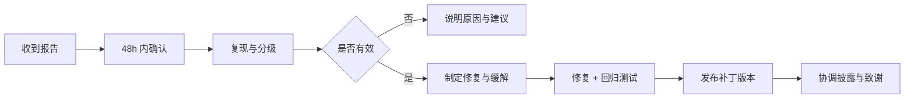

# 安全政策 · SECURITY

> 我们重视每一个安全报告。请**不要**通过公开 Issue、Discussion 或 PR 披露未修复的漏洞细节。
> 本文说明支持范围、报告方式、响应时限、安全范围与安全港条款。

## 1. 支持版本

| 版本 | 支持状态 | 说明 |
| ---- | ---- | ---- |
| `main`（最新提交） | ✅ 积极支持 | 安全修复优先合入 |
| 最新发布版 `vX.Y.Z` | ✅ 支持 | 接收修复并发布补丁版本 |
| 更早的次版本 | ⚠️ 视影响评估 | 建议升级到最新版 |
| 已归档的 `docs/` 参考工程 | ❌ 不支持 | 仅作历史参考，不用于生产 |

> 生产部署必须使用受支持版本，并保持 `JWT_SECRET`、`BIGMODEL_API_KEY` 等密钥仅存在于服务端环境变量。

## 2. 报告漏洞

- 邮箱：**admin@0379.email**
- 主题格式：`[SECURITY] YYC3-Baby-MoYu · <简短标题>`
- 建议使用加密邮件或先邮件索取公钥（如涉及高敏感数据）

请尽量提供：

1. **受影响版本/提交**（`git rev-parse HEAD`）与部署环境（Node/Bun/OS）
2. **漏洞类型**（如 XSS、SQLi、IDOR、SSRF、认证绕过、信息泄露、DoS）
3. **复现步骤**（最小化、可重复；含请求/响应或截图）
4. **影响评估**（可访问数据、所需权限、利用条件）
5. **修复建议**（可选）
6. **是否已公开**（以及计划披露时间）

⚠️ 请勿附带真实用户数据、生产密钥或大体积转储；必要时先描述再协商安全传输方式。

## 3. 响应承诺（SLA）

| 阶段 | 目标时限 |
| ---- | ---- |
| 确认收到 | 48 小时内 |
| 初步评估与分级（CVSS） | 7 天内 |
| 修复或缓解（高危/严重） | 30 天内 |
| 修复或缓解（中危） | 90 天内 |
| 修复或缓解（低危） | 按版本排期 |
| 协调披露 | 修复发布后 30 天内，或与报告者协商 |

如遇复杂问题需要更长时间，我们会同步进展与新的时间表。

## 4. 安全范围

### 4.1 纳入范围

- 认证与会话（JWT 签发/刷新/失效、Cookie 属性、CSRF 防护）
- 授权与租户隔离（横向/纵向越权、资源归属校验）
- 注入类（SQL/命令/模板/日志注入；SQL 标识符白名单绕过）
- XSS/内容注入（富文本、Markdown、用户自定义内容、`dangerouslySetInnerHTML`）
- SSRF/开放重定向（服务端请求、回调 URL、图片代理）
- 文件处理（上传类型/大小/路径穿越、图片解析）
- 密钥与配置泄露（`.env`、日志、错误页、构建产物）
- AI 链路（提示注入导致越权、密钥外泄、输出未转义）
- 依赖供应链（已知高危 CVE、恶意包、锁文件篡改）
- 拒绝服务（可控资源耗尽、无限流端点）

### 4.2 通常不纳入范围

- 需要物理接触设备或已 root/越狱环境的攻击
- 仅影响已明确不支持的归档目录/演示代码
- 缺少实际利用路径的理论问题（可作加固建议）
- 社会工程、钓鱼、垃圾邮件
- 第三方平台（GitHub、云厂商、BigModel）自身漏洞（请向其报告）
- 已知且无修复版本的依赖通告（我们会评估缓解措施）

## 5. 处理流程

修复期间可能采取的措施：临时限流、关闭受影响入口、增加校验、发布热修复。

## 6. 安全港（Safe Harbor）

对于遵循本政策、善意进行安全研究的行为，我们承诺：

- 不因该研究报告提起法律诉讼或向执法机构投诉；
- 认定研究为授权行为，前提是：不侵犯隐私、不破坏数据、不造成服务中断、
  不测试第三方系统、不公开未修复细节；
- 在修复发布后经报告者同意予以公开致谢。

如研究超出上述边界，我们保留依法维护权益的权利。

## 7. 披露与致谢

- 默认协调披露：修复版本发布后 30 天，或与报告者约定时间。
- 致谢名单会记录报告者姓名/ID（需本人同意）。
- 若发现漏洞已被主动利用，我们将优先发布缓解措施并提前披露必要信息。

## 8. 安全基线（部署必读）

- **密钥**：仅服务端环境变量；禁止 `NEXT_PUBLIC_*` 承载密钥；禁止提交 `.env*`。
- **认证**：httpOnly + SameSite=Lax Cookie；生产必须配置强随机 `JWT_SECRET`；
  access/refresh 类型不可互换；刷新令牌可撤销。
- **授权**：每个数据 API 校验登录态 + 资源归属；禁止仅靠前端隐藏。
- **输入**：服务端校验所有入参（类型/长度/枚举/范围）；SQL 参数化 + 标识符白名单。
- **输出**：用户内容默认转义；确需富文本时使用白名单净化。
- **响应头**：CSP、`X-Frame-Options`、`X-Content-Type-Options`、`Referrer-Policy` 见 `next.config.mjs`。
- **限流**：认证、AI、写操作端点必须限流；429 返回 `Retry-After`。
- **日志**：结构化日志，脱敏令牌/Cookie/手机号/邮箱；禁止记录请求体中的密钥。
- **依赖**：使用 `bun.lock` 锁定；定期升级；CI 阻止已知高危（在可用审计源下）。
- **备份**：SQLite 使用 `VACUUM INTO` 备份，备份文件加密并限制访问。

## 9. 依赖安全策略

- 项目使用 **Bun** 管理依赖（`bun.lock`）；Dependabot 配置为 `package-ecosystem: bun`。
- **OSV 审计源已接入**：`bun run audit:osv` 查询 <https://api.osv.dev/v1/querybatch>，
  覆盖 `bun.lock` 中全部 npm 包（含传递依赖），输出表格与 `osv-results.json`。
- CI 工作流 `.github/workflows/osv-audit.yml`：push（main/develop）、PR、每周一定时扫描；
  **Critical 级阻断**，High/Medium 以观察报告与 artifact 形式留档。
- 已通过 `overrides` 收敛以下传递依赖：`undici`、`js-yaml`、`moment`、`source-map-js`、`zod`。
- **残余风险（已评估）**：ESLint 工具链中的 `brace-expansion`（1.x/5.x）与 `minimatch` DoS 类通告，
  仅在构建/静态检查阶段处理不可信 glob 时可能触发，不进入运行时请求链路；
  待上游 ESLint/TypeScript-ESLint 升级链更新后随依赖升级消除。
- 安全更新优先：高危通告 30 天内升级；无法升级时记录缓解措施与到期日。
- 新增依赖须评估：维护活跃度、许可证、安装脚本、传递依赖数量。
- 禁止引入来源不明的二进制包或闭源补丁。

## 10. 事件响应（维护者）

1. 建立私密渠道与最小知情圈。
2. 复现、定级、确定影响版本与数据范围。
3. 制定修复/缓解与回滚方案，补充回归测试。
4. 发布补丁并验证部署。
5. 评估是否需要通知受影响用户/监管（按适用法律）。
6. 复盘并更新本政策与检查清单。

## 11. 联系

- 安全邮箱：**admin@0379.email**
- 项目主页：<https://baby.yyc3.vip>
- 仓库：<https://github.com/YYC-Cube/YYC3-Baby-MoYu>

---

> ***YanYuCloudCube***
> *言启象限 | 语枢未来*
> ***Words Initiate Quadrants, Language Serves as Core for Future***
> *万象归元于云枢 | 深栈智启新纪元*
> ***All things converge in cloud pivot; Deep stacks ignite a new era of intelligence***
