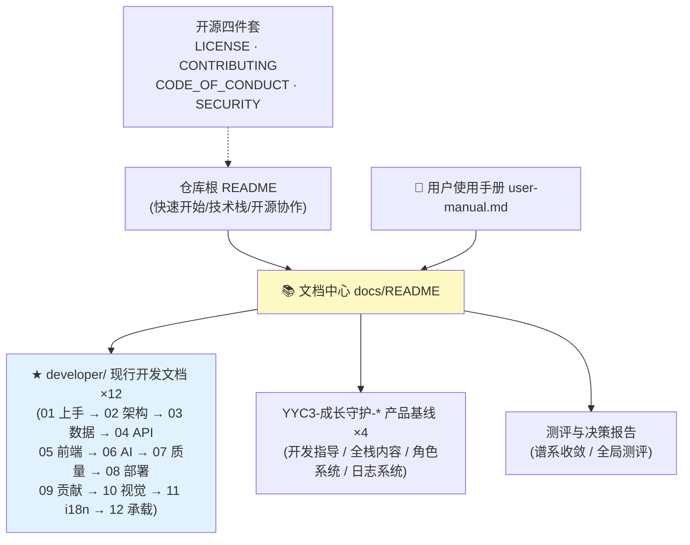

# 📚 YYC³ 文档中心

> **本目录是 YYC³ 全部文档资产的唯一入口。** 架构分层：

| 目录 | 定位 | 维护策略 |
| ---- | ---- | -------- |
| [developer/](./developer/) | ★ **现行开发文档**（12 篇，唯一被持续维护的文档集） | 随代码变更持续更新 |
| [YYC3-成长守护-开发指导/](./YYC3-成长守护-开发指导/) | 产品开发指导（需求→设计→实现对照） | 产品演进时更新 |
| [YYC3-成长守护-全栈内容/](./YYC3-成长守护-全栈内容/) | 全栈设计基线（概述/技术栈/UI 体系/库表设计/脚本 + 浮窗/语音/移动端/高可用增补，16 篇） | 产品演进时更新 |
| [YYC3-成长守护-角色系统/](./YYC3-成长守护-角色系统/) | Q 版角色/IP 矩阵/形象与情绪体系 | 角色扩展时更新 |
| [YYC3-成长守护-日志系统/](./YYC3-成长守护-日志系统/) | 成长记录/日志/时间线产品语义 | 功能演进时更新 |
| `YYC3-成长守护-未来之语/`（本地） | 0–22 岁成长寄语与阶段设计方案（gitignore，暂缓入库） | 本地维护 |
| `YYC3-小语/`（本地） | 组件拆分工作区（gitignore，本地审计用） | 本地维护 |
| `YYC3-Baby-MoYu-glm53flash-*/`（本地） | 有日期后缀的会话执行日志（gitignore，一次性产物不入库） | 本地留档 |

> 历史归档（archive/analysis/standard/status 与 20261102 两轮审计日志）已于 2026-11-05
> 移出仓库：结论均已沉淀进 developer/ 各篇， git 历史可溯。团队通用规范/开发指南以
> **SSOT `~/YYC-Cube/YYC3-团队通用-标准规范/` 为唯一事实源**，本仓不自备副本。

## 现行门禁基线（实测 2026-11-20，详见 [developer/07](./developer/07-testing-quality.md)）

| 门禁 | 基线 |
| ---- | ---- |
| `bunx tsc --noEmit` | **0 错误** |
| `bun run lint` | **0 error / 0 warning** |
| `bun run test` | **526/526**（32 文件） |
| 覆盖率 | funcs **90.06%** / lines **90.33%**（2026-11-20 实测；命令须排除 `docs/**`） |
| `check:i18n:strict` | 镜像路由 100% · 词条 986/986（CI 阻断级） |
| e2e / 视觉 | 2/2 · 8/8 |
| OSV 依赖审计 | 0 Critical / 0 High（余 1 条 moderate，dev 链） |
| 生产冒烟 | 八项断言全过（含指标令牌门禁 401 / 带令牌 200） |

## 测评与决策报告

| 文档 | 内容 |
| ---- | ---- |
| [YYC3-谱系收敛-三仓归档执行总结.md](./YYC3-谱系收敛-三仓归档执行总结.md) | 三仓冻结/归档的判据、执行记录、偏差处理与边界规则 |
| [YYC3-全局测评-Baby-MoYu-深度测评与演进规划.md](./YYC3-全局测评-Baby-MoYu-深度测评与演进规划.md) | 门禁/运行时/五维评估、风险登记册、P0–P2 路线图 |

## 文档使用路线

- **第一次接触本仓**：根 [README](../README.md) → [developer/01 快速上手](./developer/01-getting-started.md)
- **改代码前**：[developer/02 架构](./developer/02-architecture.md) + 对应领域篇（03–06）
- **提交前**：[developer/07 门禁](./developer/07-testing-quality.md) 四道全绿
- **发版/部署**：[developer/08 部署](./developer/08-deployment.md) + [12 承载分析](./developer/12-hosting-profile.md)
- **加新页面**：[developer/11 i18n 边界治理](./developer/11-i18n-boundary.md) §3（单组件复用强约定）
- **产品语义/设计溯源**：YYC3-成长守护-* 五目录
