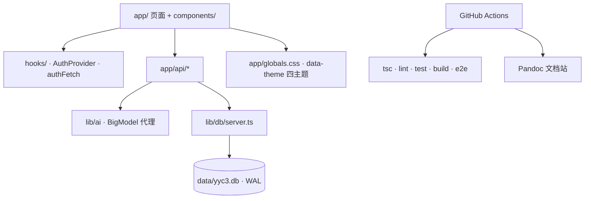

# 📊 项目现状审核报告

## 基本信息

| 属性 | 值 |
| ---- | ---- |
| **项目名称** | YYC³ 小语智能成长守护系统（YYC3-Baby-MoYu / `yyc3-xy-unified`） |
| **审核日期** | 2026-11-02 |
| **AI 导师** | TraeCode（高级实现专家模式） |
| **审核范围** | 仓库根应用、CI/CD、开源文档、依赖安全、可视化交互体系 |
| **代码基线** | 工作区未提交；本地 `main`，最近提交 `631f9f9` |
| **运行环境** | macOS · Node v22.22.3 · Bun 1.3.11 · Next.js 16.4.3 |

## 一、架构概览

### 1.1 技术栈识别

| 层级 | 技术 | 版本 | 用途 |
| ---- | ---- | ---- | ---- |
| 前端框架 | Next.js | 16.4.3 | App Router · RSC · 混合 i18n 路由 |
| UI 运行时 | React | 19.2.8 | 客户端交互 |
| 语言 | TypeScript | 5.9.3 | strict 模式 |
| 样式 | Tailwind CSS 4 + shadcn/ui + Radix UI | 4.1.x | 设计令牌 + 无障碍原语 |
| 包管理/测试 | Bun | 1.3.11 | 安装、单测、E2E 驱动 |
| 数据库 | SQLite（`node:sqlite`） | Node ≥ 22.13 | WAL · 外键 · 真实持久化 |
| 国际化 | next-intl | 4.14.9 | zh 默认 / en 前缀 |
| AI | BigModel 开放平台 | 服务端代理 | 作业批改 / 语音 / 情感分析 |
| CI/CD | GitHub Actions | — | 质量门禁 + Pandoc 文档站 |

### 1.2 模块依赖与运行形态

**结论**：单项目单实例拓扑，前后端同仓；认证/数据/AI 边界清晰；主题采用 CSS 变量级联，组件零主题分支。

## 二、代码质量评估

### 2.1 符合标准与规范的方面 ✅

- 类型检查 `tsc --noEmit` **0 error**，历史类型债已清零。
- ESLint **0 error**（56 warning，均为历史 `any`/React Compiler 债务，已显式降级为 warn）。
- 单元测试 **257/257** 全绿（19 文件），node:sqlite 直测 **7/7**，E2E **3/3**。
- 生产构建成功；关键路由静态预渲染 + API 动态路由分层合理。
- 密钥仅服务端；数据 API 认证 + 租户隔离 + 归属校验；限流与安全响应头齐备。
- 四主题（暖阳/液态翡翠/赛博霓虹/极光）令牌化，新增主题无需改组件。

### 2.2 需要改进的方面 ⚠️

| 问题 | 位置 | 严重程度 | 处置 |
| ---- | ---- | ---- | ---- |
| 根 `tsc`/`bun test` 会把 `docs/` 归档工程纳入扫描 | `tsconfig.json` / `package.json` | 🔴 高（阻断 CI） | 已排除 `docs`，测试脚本忽略 `docs/**` |
| 远程 Dependabot 持续红叉 | `.github/dependabot.yml` 缺失 | 🔴 高（阻断依赖维护） | 已新增 `bun` + `github-actions` 生态配置 |
| Pages 文档站遇空目录会传通配符给 pandoc | `deploy-pages.yml` | 🟠 中（发布失败） | 已加 `shopt -s nullglob` |
| 依赖通告（Next RCE 等） | 根依赖 | 🔴 高（安全） | 已升级 `next` 16.4.3 / `zod` 4.6.7 / `next-intl` 4.14.9 |
| 依赖审计源缺失（`bun audit` 404） | CI/安全 | 🟠 中 | 已接入 OSV.dev，Critical 阻断、High 观察 |
| 根应用缺视觉回归基线 | `e2e/` | 🟠 中 | 已补四主题 × 首页/视频工坊，darwin/linux 各 8 张 |
| lint warning 56 条 | `lib/**` | 🟡 低 | 纳入按域持续消化，不阻断 |
| 文档声明与实测不一致（251 例、0 漏洞） | README / developer | 🟡 低 | 已同步为 257 例与真实安全口径 |

### 2.3 存在风险的问题 🔴（已修复 / 待观察）

| 风险 | 位置 | 影响 | 缓解措施 |
| ---- | ---- | ---- | ---- |
| Next.js 16.3.1 已知 RCE/缓存投毒通告 | `package.json` | 生产安全 | 升级 16.4.3 并回归 build/e2e |
| `package-lock.json` 为 8 月遗留且被忽略 | 根目录 | 审计口径失真 | 明确以 `bun.lock` 为准；建议后续删除本地遗留 |
| Dependabot 使用 npm 生态无法更新 `bun.lock` | GitHub 配置 | 依赖长期停更 | 改为 `package-ecosystem: bun` |
| 远程存在长期 queued 的历史运行 | GitHub Actions | 状态噪声 | 建议手动取消过期队列（需维护者操作） |

## 三、配置审计

### 3.1 已确认配置

| 配置项 | 当前值 | 来源 | 状态 |
| ---- | ---- | ---- | ---- |
| 包管理器 | `bun@1.1.38`（本地 1.3.11） | `package.json` / `bun.lock` | ✅ |
| Node 引擎 | `>=18`（实际推荐 ≥22.13） | `package.json` / README | ⚠️ 建议对齐 ≥22.13 |
| CI Node | 22 | `ci.yml` | ✅ |
| CI 触发 | push `main/develop` + PR `main` | `ci.yml` | ✅ |
| 并发控制 | `ci-${{ github.ref }}` + 取消旧运行 | `ci.yml` | ✅ 新增 |
| 权限 | `contents: read` | `ci.yml` | ✅ 新增 |
| 超时 | 30 分钟（CI）/ 15 分钟（Pages） | 工作流 | ✅ 新增 |
| Dependabot | Bun + GitHub Actions，周一 04:00/04:30（Asia/Shanghai） | `.github/dependabot.yml` | ✅ 新增 |
| Pages 发布路径 | `docs/**`、`README.md`、`public/CNAME`、工作流 | `deploy-pages.yml` | ⚠️ 建议加 `public/**` |
| 顶图 | `public/yyc3-family.png` | README | ✅ 已规范小写 |

### 3.2 待确认配置

| 配置项 | 发现位置 | 建议值 | 风险说明 |
| ---- | ---- | ---- | ---- |
| `engines.node` | `package.json` | `>=22.13` | 低版本会缺 `node:sqlite` |
| `repository.url`/`homepage` | `package.json` | 当前已补全 | — |
| Dependabot 嵌套工作区 | `docs/YYC3-小语/YYC3-XY-WORKSPACE` | 单独 `bun` 目录或保持人工维护 | 嵌套锁文件可能不被识别 |

## 四、安全评估

### 4.1 敏感信息检查

- [x] 源码目录扫描未发现 `sk-*` / `ghp_*` / `AKIA*` / 明文口令
- [x] `.env*` 已 gitignore，`data/` 不入库
- [x] 密钥仅服务端读取；AI 走代理路由
- [x] 认证使用 httpOnly Cookie + CSRF Origin 校验 + 限流
- [x] 依赖审计已接入 OSV.dev（814 包，0 Critical；High/Medium 报告留档）
- [ ] 残余 `brace-expansion`/`minimatch`（仅 ESLint 构建链路）待上游升级消除

### 4.2 安全结论与建议

- **已处置**：升级 Next.js 至 16.4.3，关闭已知 RCE/缓存类高危通告；同步升级 zod/next-intl。
- **已接入**：OSV.dev 审计源（`audit:osv` + CI 定时/PR 扫描，Critical 阻断；High/Medium 留档观察）。
- **待持续**：`brace-expansion`/`minimatch` 残余通告（仅 ESLint 构建链路），随上游升级链消除。
- **建议**：删除本地遗留 `package-lock.json`（已忽略），避免误导审计；生产环境强制强随机 `JWT_SECRET`。

## 五、文档与开源成熟度

| 项 | 审核前 | 审核后 |
| ---- | ---- | ---- |
| README | 有技术栈/脚本，但徽章静态、缺主题标签与社区入口 | 动态 CI/文档徽章、关键词标签、可视化交互章节、开源协作区、四行署名 |
| 开发者文档 | 10 篇 | **11 篇**（新增《10 · 可视化交互体系设计》） |
| LICENSE | MIT（基础） | MIT + 项目标识 + 第三方资产/商标说明 |
| CODE_OF_CONDUCT | 简版 | Contributor Covenant v2.1 完整适配 + 四级执行指南 |
| CONTRIBUTING | 简版 | 环境/分支/提交/代码规范/门禁/PR 清单/发布/安全全流程 |
| SECURITY | 简版 | 支持矩阵/SLA/范围/安全港/基线/依赖策略/事件响应 |
| Issue/PR 模板 | 缺失 | Bug/Feature 表单 + PR 检查清单 |

## 六、五维评估

| 维度 | 评分（0–100） | 依据 |
| ---- | ---- | ---- |
| 时间维（构建/反馈效率） | 88 | build 约 1.5s 级；e2e 3.7s；CI 30 分钟上限 |
| 空间维（结构与边界） | 86 | 单仓单实例；`app/api/lib` 边界清晰；docs 归档需隔离（已做） |
| 属性维（质量/安全） | 84 | tsc/lint/test 全绿；Next 已升级；剩余依赖通告待审计源 |
| 事件维（交互/错误处理） | 82 | 四态覆盖较好；根应用缺视觉回归；lint 债务 56 |
| 关联维（生态/依赖） | 86 | Dependabot 修复；workspace 独立门禁；Bun/pnpm 双生态需持续对齐 |

**综合评分：84 / 100 — 有条件通过（修复项已闭环，待推送验证远程 CI）**

## 七、下一步行动建议

1. **[P0]** 将本轮修复推送至 `main`，观察 `CI`、`Deploy Docs`、`Dependabot` 三条流水线是否转绿。
2. **[P0]** 取消长期 `queued` 的历史运行（维护者操作），恢复 Actions 状态可信度。
3. **[P1]** 为根应用补 Playwright 视觉基线（四主题 × 移动/桌面），纳入 CI。
4. **[P1]** 建立依赖审计源（OSV/GitHub Advisory），高危阻断；清理本地 `package-lock.json`。
5. **[P2]** 按域消化 56 条 lint warning（优先 `lib/utils.ts`、`lib/api/voice-services.ts`）。

---

**审核结论**：有条件通过（P0 修复已本地验证，待推送后远程复核）
**下次审核建议时间**：2026-11-09

---

> ***YanYuCloudCube***
> *言启象限 | 语枢未来*
> ***Words Initiate Quadrants, Language Serves as Core for Future***
> *万象归元于云枢 | 深栈智启新纪元*
> ***All things converge in cloud pivot; Deep stacks ignite a new era of intelligence***
