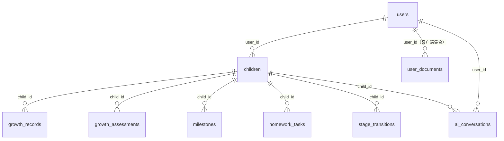

# 03 · 数据模型

> 存储：`node:sqlite`（文件级 SQLite，WAL 模式，外键约束开启），库文件 `data/yyc3.db`（已 gitignore）。
> 定义源码：`lib/db/sqlite-client.ts`（建表 SQL）与 `lib/db/schema.ts`。

## 实体关系



## 十张表

| 表 | 用途 | 关键列 | JSON 列（自动序列化） |
| ---- | ---- | ---- | ---- |
| `users` | 家长账户 | email(唯一)、role、password_hash、first_name/last_name、is_active、email_verified（JWT 鉴权，P0-1 融合） | — |
| `children` | 宝宝档案 | birth_date、gender、current_stage | — |
| `growth_records` | 成长记录 | type(milestone/observation/emotion/learning)、recorded_at | media_urls、tags |
| `growth_assessments` | 成长评估 | overall_score、stage_id | dimensions、recommendations |
| `milestones` | 里程碑 | milestone_type、achieved_at | celebration_data |
| `ai_conversations` | AI 对话存档 | session_id | messages |
| `homework_tasks` | 作业任务 | status(pending/in_progress/completed/overdue)、priority | — |
| `courses` | 课程 | subject、difficulty_level(1-5) | content、media_urls、tags |
| `stage_transitions` | 成长阶段变迁 | from_stage→to_stage | — |
| `user_documents` | **客户端集合持久化**（课表/日程/互动/视频/评估） | `user_id` + `kind` + `doc_id`（唯一索引 `(user_id,kind,doc_id)`） | payload |

索引已覆盖全部外键列与高频查询列（recorded_at / due_date / status 等）。

## `user_documents` 设计说明（2026-11-02 引入）

**为什么是 JSON 文档表而不是四张宽表**：这四类集合只在客户端「整组读写」，服务端无聚合查询需求；
为异构结构各建一张宽表会带来 4 套 DTO + 4 套迁移，收益为负。待出现统计/检索需求时再迁移为专用表。

| 字段 | 说明 |
| ---- | ---- |
| `kind` | 白名单：`schedule` / `curriculum` / `interaction` / `video` / `assessment` |
| `doc_id` | 客户端生成的项目 id（同一用户、同一 kind 内唯一） |
| `payload` | 该项目完整对象（JSON，单条 ≤64 KB，单组 ≤500 条、总量 ≤1 MB） |

**读写语义**：`GET` 按 `kind` 整取；`PUT` 为 **replace-all**（事务内先删后插）；`DELETE` 按 `kind` 清空。
客户端由 `lib/client/collection-store.ts` 负责「本地缓存 + 防抖推送 + 一次性迁移」，游客降级为仅本地。

**已知限制（待立项）**
1. 学期配置（`yyc3_semester`）仍留在 localStorage（单对象配置，未并入集合）。
2. 多标签页并发编辑为「后写覆盖」，家庭单用户场景可接受；如需强一致需引入版本号/冲突合并。

> `growth_assessments` 已于 2026-11-02 补齐写路径（`POST /api/growth-assessments`），
> 评估报告页「保存报告」按钮现已真实落库。

## 数据库驱动：SQLite（默认）/ PostgreSQL 15（可选）

`lib/db/driver.ts` 按环境变量选择实现，业务代码与 `lib/db/server.ts` 零改动：

| 变量 | 取值 | 行为 |
| ---- | ---- | ---- |
| `DB_DRIVER` | `sqlite`（默认）/ `postgres` | 显式指定驱动 |
| `DATABASE_URL` | 文件路径 / `postgres://…` | 未设 `DB_DRIVER` 时按协议自动判定 |
| `PG_POOL_MAX` | 默认 10 | PG 连接池上限（单实例应用建议 ≤20） |
| `SEED_DEMO` | 默认 false | PG 模式默认不种演示数据 |

**两套 schema 刻意同构**（日期/JSON 为 TEXT、布尔为 INTEGER），因此 JSON 列转换、分页、IN 查询逻辑完全复用。
PG 侧关键差异已处理：连接池 + `AsyncLocalStorage` 绑定事务连接（否则 `BEGIN/COMMIT` 会落在不同连接上）。

### 迁移（SQLite → PG）

```bash
# 1) 建库（示例：本机 PG15 5433）
createdb -h 127.0.0.1 -p 5433 -U yanyu yyc3_baby_moyu

# 2) 迁移（自动建表 + 幂等插入 + 行数比对）
bun run db:migrate:pg -- --sqlite data/yyc3.db \
  --pg postgres://yanyu@127.0.0.1:5433/yyc3_baby_moyu

# 3) 以 PG 启动（可随时回退 sqlite）
DB_DRIVER=postgres DATABASE_URL=postgres://… bun run start
```

**回退开关**：改回 `DB_DRIVER=sqlite` 即回到 SQLite；双跑窗口内 SQLite 文件保持不变。
备份：PG 用 `pg_dump --format=custom`（`backup()` 在 PG 模式下会明确提示改用 pg_dump）。

## JSON 列约定（重要）

数据库内 JSON 列以**字符串**存储；`lib/db/server.ts` 提供双向透明转换：

- 写入（`createRow/updateRow`）：数组/对象自动 `JSON.stringify`
- 读取（`listRows/getRow`）：自动 `JSON.parse`，坏值容错为 `[]`
- **API 层永远只见结构化数据，不见 JSON 字符串**

## 服务端访问层

```ts
// app/api/*/route.ts 中唯一推荐用法
import { listRows, createRow, getRow, updateRow, deleteRow, isForeignKeyError } from "@/lib/db/server"

const rows = await listRows("growth_records", { child_id: id }) // 表名白名单校验
const created = await createRow("children", { ... })            // 自动补 id/created_at
```

禁止在路由中直接拼 SQL 或引用 `sqlite-client` 的原始方法（绕过白名单与序列化）。

## 种子数据

首次访问任意数据接口时自动执行 `seedMockData()`（幂等：已有 users 数据则跳过）：
示例用户「张女士」→ 宝宝「小语」→ 1 条里程碑记录 + 2 个作业任务 + 2 门课程。

重置：删除 `data/yyc3.db*` 后重启。

## 备份

```ts
getDatabase().backup("./backups/snapshot.db")   // VACUUM INTO，在线安全备份
```

未来扩展（路线图）：PostgreSQL 适配层位于 `lib/db/client.ts` 接口抽象之后，替换 `SQLiteDatabase` 实现即可。
