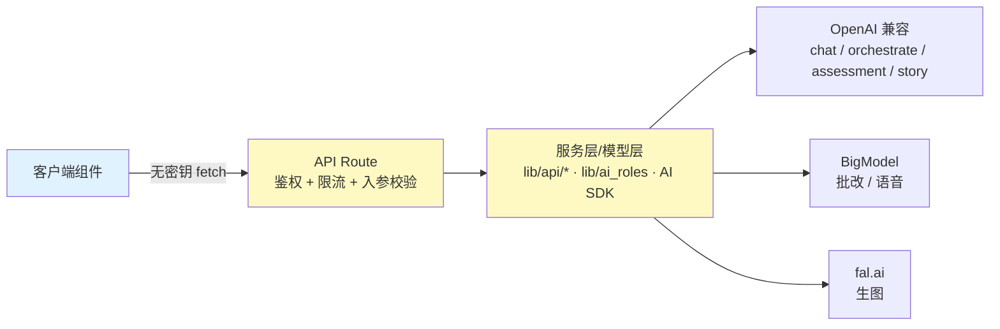

# 06 · AI 能力矩阵与密钥治理

> 本文以**代码为准**：每个能力标注实现形态、所需密钥、缺省行为。
> 变更此文档时，必须同步 `app/api/ai/*` 与 `.env.example`，否则视为文档缺陷。

## 0. 能力矩阵（以 `app/api/ai/` 与 `core/` 实机核对）

| 能力 | 端点 | 实现形态 | 所需密钥 | 缺省/失败行为 |
| ---- | ---- | ---- | ---- | ---- |
| 育儿对话 | `POST /api/ai/chat` | 模型优先 + 示例兜底；SSE 首帧 `{type:"meta",demo:boolean}` | `OPENAI_API_KEY`（可选 `OPENAI_BASE_URL`） | 无密钥 → 示例话术并置 `demo:true`；模型报错 → 同样降级且 `demo:true` |
| 多角色编排 | `POST /api/ai/orchestrate` | OpenAI 兼容模型 `gpt-4o-mini`，按复杂度单/双/多角色调用 | `OPENAI_API_KEY` | 未配置 → 500「服务配置错误」 |
| 发展评估报告 | `POST /api/ai/assessment-report` | 同上 + 维度分数规则计算 | `OPENAI_API_KEY` | 未配置 → 5xx |
| 故事续写 | `POST /api/ai/continue-story` | 同上 + 7 种风格模板 | `OPENAI_API_KEY` | 未配置 → 5xx |
| 生图 | `POST /api/ai/generate-image` | fal.ai FLUX schnell | `FAL_KEY` | 无密钥/失败 → 返回 `placeholder.svg` 且 `isPlaceholder:true` |
| 作业批改 | `POST /api/ai/homework-correction` | BigModel 视觉模型（`lib/api/homework-correction.ts`） | `BIGMODEL_API_KEY` | 未配置 → 500；图片上限 10 MB |
| 语音转写 | `POST /api/ai/speech-to-text` | BigModel ASR（`lib/api/voice-services.ts`） | `BIGMODEL_API_KEY` | 未配置 → 500；音频上限 25 MB |
| 情感分析 | `POST /api/ai/emotion` | **本地情感词典规则**（非模型） | 无 | 始终可用；置信度为词典命中比例 |
| 多模态情绪融合 | `POST /api/ai/enhanced-emotion` | `lib/ai/enhanced-emotion-fusion.ts` 规则融合 | 无 | 始终可用 |
| 记录智能分析 | `POST /api/ai/analyze-record` | 标题截断 + 关键词判定（示例实现） | 无 | 始终可用；**非模型推理** |
| 自治引擎 | `POST /api/agentic` | `core/AgenticCore.ts`（任务分解 + 预测管线，**不调用大模型**） | 无 | 始终可用；单例运行于服务端 |

> 结论：**接入大模型的只有 5 条**（chat / orchestrate / assessment-report / continue-story / homework-correction + speech 走 BigModel），
> 其余为规则或本地算法。任何对外表述都不得把规则引擎称为「AI 大模型推理」。

## 1. 密钥管理铁律

1. 三类密钥，全部只进服务端：`BIGMODEL_API_KEY`、`OPENAI_API_KEY`（+ `OPENAI_BASE_URL`）、`FAL_KEY`。
2. **永远不要**加 `NEXT_PUBLIC_` 前缀——该前缀会把值打进浏览器包。
3. 浏览器组件只 `fetch("/api/ai/*")`，**禁止** import `lib/api/*` 服务模块（其中直接读取 `process.env`）。
4. `.env.example` 必须列出全部在用的变量；新增读取点必须同步补样板。
5. 密钥进过 git 历史：唯一处置是控制台轮换 + 清理本地备份，不做历史改写以外的补救。

## 2. 服务端代理模式



新增 AI 能力的四步（缺一步即返工）：
`lib/api/xxx.ts`（封装/超时/重试）→ `app/api/ai/xxx/route.ts`（`guardAIRequest` + zod 入参 + 体积上限）→
**缺密钥的显式降级**（必须让前端可感知，如 `demo`/`isPlaceholder` 标记）→ 客户端 fetch + 状态提示。

## 3. 模块清单（真实存在，非规划）

| 路径 | 职责 |
| ---- | ---- |
| `lib/ai_roles.ts` | 6 类角色人设与 `systemPrompt`、按上下文选角色、复杂度分析 |
| `lib/ai/emotion-types.ts` | 情绪类型与维度定义 |
| `lib/ai/enhanced-emotion-fusion.ts` | 文本/音频/面部/肢体特征的规则融合 |
| `lib/api/ai-guard.ts` | AI 端点统一守卫（登录 + 按用户限流，429 带 `Retry-After`） |
| `lib/api/voice-services.ts` | BigModel TTS/ASR 封装（重试、网络错误识别） |
| `lib/api/homework-correction.ts` | BigModel 作业批改全流程（上传 → 批改 → 分析） |
| `lib/prediction/{base-predictor,adaptive-ensemble,specialized-engines}.ts` | 预测引擎基座与专项引擎 |
| `services/prediction/{model-selector,quality-monitor}.ts` | 动态模型选择与质量监控 |
| `core/{AgenticCore,agent-state}.ts` + `lib/agentic/server.ts` | 自治核心与服务端单例 |
| `lib/rate-limit.ts` | 进程内固定窗口限流（单实例语义） |

**空目录说明**：`lib/{growth,intelligence,ml,performance,voice}` 目前**无任何文件**。
历史上文档曾把若干规划模块列为「已接线」，属于事实错误；如需落地请新建文件并在此登记。

## 4. 限流基线（按用户 + 端点，窗口 60s）

| 端点 | 配额/分钟 | 说明 |
| ---- | ---- | ---- |
| `chat` | 20 | 对话主入口 |
| `emotion` / `enhanced-emotion` / `analyze-record` | 30 | 本地计算，成本低 |
| `orchestrate` / `assessment-report` / `continue-story` | 10 | 中/高复杂度会触发多次模型调用 |
| `homework-correction` / `speech-to-text` | 10 | 按次计费的上游 |
| `generate-image` | 6 | 按张计费，配额从严 |
| `agentic`（`/api/agentic`） | 20 | 自治引擎，独立于 AI 路由 |

## 5. AgenticCore 的真实位置

- 运行在**服务端**：`app/api/agentic/route.ts` → `lib/agentic/server.ts` 单例 → `core/AgenticCore.ts`。
- 客户端 `components/ai-widget/IntelligentAIWidget` 只经 `authFetch("/api/agentic")` 调用，不再本地实例化引擎。
- 其内部为任务分解 + 模型选择 + 预测管线，**不发起大模型请求**；不要表述为「大模型推理」。

## 6. 安全响应头

`next.config.mjs` 为全部路由注入：`X-Content-Type-Options: nosniff`、`X-Frame-Options: SAMEORIGIN`、
`Referrer-Policy: strict-origin-when-cross-origin`、`Permissions-Policy`（camera/geolocation 关闭，microphone 仅自源）；
生产环境追加 CSP（`script-src` 目前仍含 `'unsafe-inline'`，见知识债清单）。

## 7. 密钥轮换流程

1. 对应控制台新建 Key（BigModel / OpenAI 兼容 / fal.ai）。
2. 更新 `.env.local`（**不提交**），同步部署环境变量。
3. 冒烟验证（以 BigModel 为例，模型名以控制台可用型号为准）：

   ```bash
   curl -s https://open.bigmodel.cn/api/paas/v4/chat/completions \
     -H "Authorization: Bearer $BIGMODEL_API_KEY" \
     -H "Content-Type: application/json" \
     -d '{"model":"glm-4-flash","messages":[{"role":"user","content":"OK"}]}'
   ```

4. 删除旧 Key 的一切本地备份，观察 24h 日志中的 401/429。
