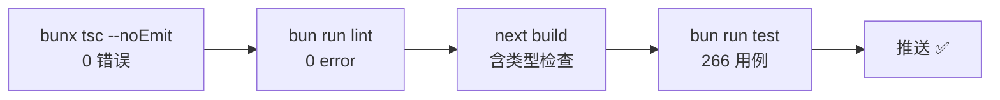

# 07 · 测试与质量门禁

## 四道门禁（提交前应全绿）



| 门禁 | 命令 | 当前基线 |
| ---- | ---- | ---- |
| 类型 | `bun run type-check` | **0 错误**（应用代码；`__tests__/`、`themes/` 排除） |
| Lint | `bun run lint` | **0 error**，51 warning（见债务清单） |
| 构建 | `bun run build` | 通过（类型门禁已恢复，无 ignoreBuildErrors） |
| 测试 | `bun run test` | 266/266（21 文件，~1.8s；含鉴权/越权/限流类安全行为用例） |
| DB 直测 | `bun run test:node` | 7/7（SQLite）；设置 `PG_TEST_URL` 后 +5 条 PG 用例（共 12/12，CI 默认跳过 PG） |
| e2e | `bun run test:e2e` | 3/3（登录→建娃→写记录→登出 / 匿名 401 矩阵 / 敏感页重定向；生产构建，账号自举不依赖种子） |
| 视觉 | `bun run test:visual` | 8/8（首页/视频工坊 × 四主题；darwin/linux 分平台基线） |
| 依赖 | `bun run audit:osv` | OSV.dev 审计；Critical 阻断，High/Medium 输出 `osv-results.json` |

> 2026-11-02 复核实测：tsc 0 error · lint 0 error/51 warning · 266/266 · node 7/7 · build 成功（编译 ~1.9s）·
> e2e 3/3 · 四主题视觉 8/8。数字以本节为准，变更门禁时请同步刷新。

## 测试套件结构（按目录实况）

```
__tests__/
├── api/                    auth-routes（登录/注册/刷新/限流/令牌类型）
│                           data-routes（children/growth/homework 的 401·403·IDOR·白名单）
│                           ai-chat（401/400/demo 降级/role 回落/429）
│                           user-documents（kind 白名单/覆盖语义/隔离/体积与条数上限）
│                           growth-assessments（401/400/403/201/分页夹取 + health 200/503）
├── lib/                    badges · auth · auth/jwt-type · rate-limit · theme-system
│                           character-manager · config · db/identifier · utils
│                           api/auth-fetch（401→刷新→重试并发锁）
├── hooks/                  hooks.test.bun · useAccessibility · useGrowthRecords
├── components/common/      LanguageSwitcher
├── pages/                  settings · profile
└── utils/                  helpers
```

> 已删除 `__tests__/hooks/useAIChat.test.ts`：该文件在测试内**自定义**同名 Hook 并断言自身，
> 生产代码中不存在该模块，属「自证型用例」，会虚增通过数。对应能力改由 `api/ai-chat.test.ts` 覆盖真实端点。

运行时：Bun test + jsdom（`bun.test.preload.ts` 提供 DOM 环境与 framer-motion mock）。

**测试写法范式**（以徽章引擎为例）：纯函数 → 直接断言；Hook → bun:test + renderHook 风格；组件 → jsdom 渲染 + 行为断言。中文用例名与产品语言一致。

## Lint 债务清单（warning 级，按域消化）

| 规则族 | 存量 | 说明 |
| -------- | ------ | ------ |
| no-explicit-any / no-unsafe-* | ~300 | 历史 any，按目录改 typed |
| require-await | ~120 | 同步实现的 async 接口（既有 API 契约，改动需评估调用方） |
| no-floating-promises | ~116 | UI 事件 fire-and-forget，补 `void`/`.catch` |
| React Compiler（immutability/purity/refs/static-components） | ~90 | React 19 编译器兼容整改 |
| no-confusing-void-expression | ~100 | 风格，`lint:fix` 可清 |

每清一个规则族 → 在 `eslint.config.js` 把它升回 `error`，防止回潮。

## 类型债治理史（存档）

1,986（合并初期）→ 990（tsconfig 标准化）→ 804（themes 排除+补类型族）→ 415（完整化阶段）→ **0**（清零冲刺，2026-08-19）。当前维持 0 错误基线（`bunx tsc --noEmit` 全量校验）。
