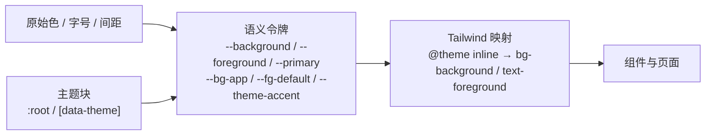
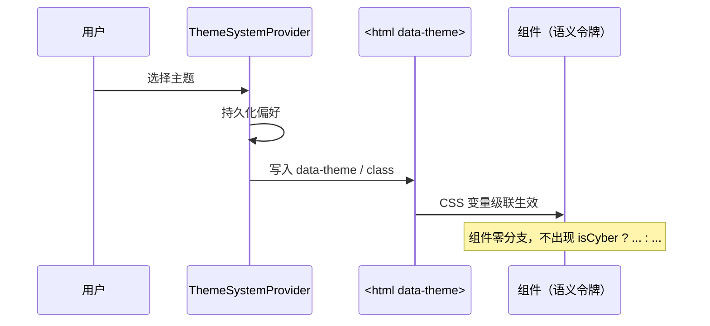
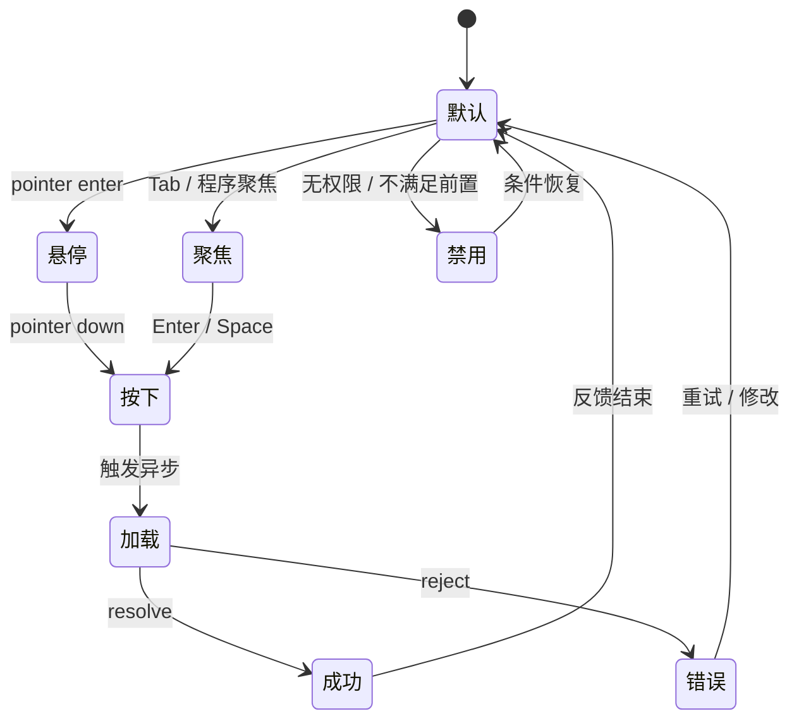
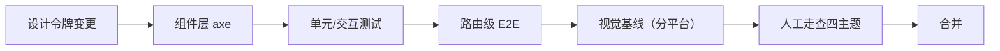

# 10 · 可视化交互体系设计

> 本文是 YYC³ 小语智能成长守护系统的**视觉与交互单一事实源（Visual & Interaction SSOT）**。
> 适用于 `app/`、`components/`、`styles/` 的新增与改造；与《02 · 可视化架构体系》《05 · 前端组件体系》互补：
> 02 讲系统怎么分层，05 讲组件怎么组织，本文讲**界面为什么这样呈现、交互为什么这样反馈**。

---

## 1. 设计目标与评价维度

### 1.1 一句话目标

让 0–12 岁儿童的家庭在**低认知负担、高情感温度、可无障碍使用**的界面中完成成长记录、陪伴与探索。

### 1.2 五维评价（每个界面改动都按此自检）

| 维度 | 关键问题 | 验收信号 |
| ---- | ---- | ---- |
| 时间维 | 首屏与交互反馈是否足够快？ | 首屏关键内容 2.5s 内可见；交互反馈 ≤ 100ms；骨架屏不闪烁 |
| 空间维 | 信息层级是否清晰、留白是否足够？ | 单屏不超过 3 个视觉焦点；卡片间距遵循 4pt 栅格 |
| 属性维 | 色彩/对比度/可读性是否达标？ | 正文对比度 ≥ 4.5:1；大字 ≥ 3:1；不依赖颜色传达状态 |
| 事件维 | 每个操作是否有明确反馈与可恢复路径？ | 成功/失败/空态/加载态齐备；破坏性操作二次确认；错误可重试 |
| 关联维 | 组件、主题、数据、无障碍是否一致？ | 换主题零组件分支；同一语义只用一个令牌；键盘全流程可完成 |

### 1.3 五高落地

- **高可用**：错误边界 + 空态 + 重试；不因单个接口失败白屏。
- **高性能**：CSS 令牌与 `transform/opacity` 动效；避免布局抖动与长任务。
- **高安全**：敏感操作确认、权限态明确、错误信息不泄露内部细节。
- **高扩展**：新增主题 = 新增 `data-theme` 令牌块；新增组件 = 复用状态与令牌。
- **高智能**：AI 结果标注置信度、可追溯来源、可人工修正。

---

## 2. 视觉基础层（Design Tokens）

### 2.1 令牌分层

**硬规则**：组件与页面禁止直接写十六进制/`rgb()` 颜色；必须引用语义令牌或语义工具类
（`.text-adaptive`、`.bg-surface`、`.border-soft`、`.text-theme-accent`）。
历史硬编码色按页面渐进迁移，新增代码一律不允许。

### 2.2 色彩体系

| 类别 | 令牌 | 默认值（` :root `） | 用途 |
| ---- | ---- | ---- | ---- |
| 页面底色 | `--bg-app` | `#fffbeb`（暖阳） | 应用最底层背景 |
| 表面 | `--bg-surface` / `--bg-surface-soft` | `#ffffff` / `#fef3c7` | 卡片、次级卡片 |
| 正文 | `--fg-default` | `#1f2937` | 主要文本 |
| 次要文本 | `--fg-muted` | `#6b7280` | 辅助说明（仍须 ≥ 4.5:1） |
| 边框 | `--border-soft` | `#f3e8c8` | 卡片描边、分隔 |
| 主题强调 | `--theme-accent` / `--theme-accent-fg` | `#f59e0b` / `#ffffff` | 主行动、选中态 |
| 主题光晕 | `--theme-glow` | `rgba(245,158,11,.18)` | 悬浮/选中光晕 |
| shadcn 语义 | `--background` / `--foreground` / `--card` / `--popover` / `--primary` / `--muted` / `--border` / `--ring` / `--destructive` | OKLCH | Radix 浮层与表单控件 |
| 图表 | `--chart-1` … `--chart-5` | OKLCH | 数据可视化序列色 |
| 侧栏 | `--sidebar-*` | OKLCH | 侧栏容器与选中态 |

**状态色语义**：

- 成功：优先使用主题强调 + 文案/图标双重编码，禁止仅用绿色。
- 警告/错误：`--destructive` 用于错误文本与危险按钮；错误容器需同时提供图标与可读文案。
- 中性禁用：降低不透明度不得低于 60%，且必须保留可聚焦说明（`aria-disabled`）。

### 2.3 字体与排版

| 场景 | 字体栈 | 说明 |
| ---- | ---- | ---- |
| 正文/UI | `'Inter', 'PingFang SC', 'Microsoft YaHei', sans-serif` | 中英混排稳定 |
| 儿童向标题 | `'YouYuan', 'Varela Round', sans-serif`（`.font-rounded`） | 仅用于标题/强调，正文禁用 |

排版约束：

- 正文最小 14px；辅助文本最小 12px 且必须满足对比度。
- 标题层级 `h1 > h2 > h3` 不跳级；页面只保留一个 `h1`。
- 行高正文 1.6–1.75，标题 1.25–1.35；中文段落禁止两端强制拉伸。
- 数字统计数据使用 `tabular-nums`，避免刷新时跳动。

### 2.4 间距、圆角、阴影

| 令牌 | 值 | 用途 |
| ---- | ---- | ---- |
| 间距基数 | 4px | 所有 margin/padding 为 4 的倍数 |
| `--radius` | `0.625rem` | 卡片/输入默认圆角 |
| `--radius-sm/md/lg/xl` | 基于 `--radius` 派生 | 小控件/常规/卡片/大容器 |
| `--shadow-soft` | `0 10px 25px -5px rgba(148,163,184,.15)` | 卡片悬浮 |
| `--shadow-glow` | `0 0 15px rgba(255,183,77,.4)` | 主题强调光晕（克制使用） |

**层级（z-index）约定**：内容 0–10；粘性头部 20–30；浮层 40；全局导航 50；
Toast/命令面板 60；调试/开发工具不得高于 60。

---

## 3. 主题系统

### 3.1 主题清单

| 主题 | `data-theme` | 明暗 | 气质 | 关键令牌 |
| ---- | ---- | ---- | ---- | ---- |
| 暖阳（默认） | 无（`:root`） | 浅色 | 温和、亲子 | `--theme-accent: #f59e0b` |
| 液态翡翠 | `liquid` | 浅色 | 清新、成长 | `--theme-accent: #10b981` |
| 赛博霓虹 | `cyberpunk` | 深色 | 科技、探索 | `--theme-accent: #00f0ff` |
| 极光 | `aurora` | 深色 | 梦幻、夜间 | 极光渐变 + 粒子动效 |

### 3.2 切换机制

要求：

- 主题切换只改 `<html>` 属性，不触发组件重渲染树。
- 首屏必须在 hydration 前应用已保存主题，避免闪烁（阻塞脚本或服务端读取偏好）。
- 新增主题必须提供**完整**的兄弟令牌与 shadcn 语义令牌，不得只覆盖部分变量。
- 深色主题必须定义 `color-scheme: dark`，保证原生控件与滚动条一致。

### 3.3 主题验收清单

- [ ] 四主题下正文/次要文本对比度达标（含浮层与禁用态）。
- [ ] 焦点环在任意背景可见（`outline` 不被裁切）。
- [ ] 图表序列色在深浅主题均可区分（不仅靠色相）。
- [ ] 图片/插画在深色下无白色硬边。
- [ ] 极光/赛博动效可被 `prefers-reduced-motion` 关闭。

---

## 4. 交互状态机

每个可交互元素必须覆盖以下状态，缺一不可：

| 状态 | 视觉要求 | 语义要求 |
| ---- | ---- | ---- |
| 默认 | 令牌色 + 1px 软边框 | 可访问名称完整 |
| 悬停 |  elevation +1 或背景加深 ≤ 8% | 不改变布局尺寸 |
| 聚焦 | 2px 焦点环 + 2px 偏移，禁止 `outline: none` | 键盘可见，`:focus-visible` 生效 |
| 按下 | 缩放 ≤ 0.98 或位移 ≤ 2px | 不触发重复提交 |
| 加载 | 按钮内联 spinner + 保持宽度 | `aria-busy="true"`，禁止二次点击 |
| 禁用 | 透明度 ≥ 60% | `aria-disabled` + 原因提示（tooltip/说明） |
| 错误 | 错误色 + 图标 + 文案 + 重试 | `role="alert"` / `aria-live="assertive"` |
| 成功 | 轻量 Toast 或内联确认 | `aria-live="polite"`，不遮挡主操作 |
| 空态 | 插画/图标 + 一句解释 + 一个行动 | 空态不是错误态，文案不得指责用户 |

**防抖与幂等**：提交类按钮在 pending 期间锁定；表单 `onSubmit` 唯一入口，禁止 `type=submit` 与 `onClick` 双绑定。

---

## 5. 关键交互模式

### 5.1 导航

- 顶部/底部导航保持稳定位置；当前页使用 `aria-current="page"`。
- 移动端底部导航项 ≥ 44×44px，标签常显，不用纯图标猜测。
- 深层页面提供返回；返回不得丢失未提交表单（需确认对话框）。
- 国际化路由：`/` 中文默认，`/en` 英文；切换语言保持当前路径语义。

### 5.2 浮层（Dialog / Sheet / Popover / Dropdown）

- 必须包含标题与描述（`DialogTitle` + `DialogDescription`，视觉可隐藏但语义不可缺）。
- 打开后焦点移入第一个可交互元素；关闭后焦点回到触发元素。
- `Esc` 关闭、点击遮罩关闭策略按风险分级：破坏性确认框禁止遮罩关闭。
- 浮层层级高于导航；不得嵌套超过两层。

### 5.3 表单

- 标签常显，禁止仅用 placeholder 充当标签。
- 校验时机：失焦校验 + 提交校验；错误紧邻字段并 `aria-describedby` 关联。
- 必填标识同时提供文案（`必填`），不仅用星号。
- 长表单分组，单组 ≤ 7 个字段；危险操作与保存分离。

### 5.4 列表与卡片

- 卡片整卡可点击时，内部不得再嵌套其他可点击控件（避免事件冲突）。
- 列表项提供 hover/selected/focus 三态；选中态不仅靠底色，需加边框或勾选图标。
- 长列表使用虚拟滚动或分页；空搜索与无数据使用不同文案。
- 时间线/成长记录按时间倒序，时间格式统一 `YYYY-MM-DD`。

### 5.5 反馈与通知

| 场景 | 组件 | 时长/规则 |
| ---- | ---- | ---- |
| 轻量成功 | Toast（sonner） | 3–5s 自动消失，可手动关闭 |
| 需要决策 | Dialog | 阻塞，必须显式选择 |
| 表单错误 | 内联 message | 常驻至修正 |
| 系统级错误 | ErrorBoundary / 页面错误态 | 提供重试与反馈入口 |
| 异步加载 | Skeleton | 结构占位，避免 spinner 闪烁 |
| 进度 | Progress | 有明确总量时使用百分比；否则用不确定态 |

### 5.6 儿童与家长双角色

- 儿童面向：大按钮、少文字、正向鼓励、动效柔和、无倒计时压力。
- 家长面向：信息密度更高、可批量操作、数据可导出、隐私说明清晰。
- 同一页面同时服务两类角色时，以家长为主导航、儿童内容为沉浸区，避免权限混淆。

---

## 6. 数据可视化

### 6.1 图表使用原则

- 先问「这张图要支持什么决策」，无决策价值不做图。
- 单一序列优先条形/折线；占比 ≤ 5 类才用饼图；时间趋势用折线。
- 坐标轴从 0 开始（条形图必须），避免夸大差异。
- 颜色不是唯一编码：同时使用标签、图案或直接数值。
- 图表容器必须给定高度，禁止依赖父级自动高度导致布局跳动。

### 6.2 组件与令牌

- 统一使用 `components/ui/chart.tsx`（Recharts 封装）：`ChartContainer` + `ChartTooltipContent` + `ChartLegendContent`。
- 序列色只用 `--chart-1` … `--chart-5`；新增序列需先扩展令牌，不写死十六进制。
- Tooltip 必须显示「名称 + 数值 + 单位」；大数字使用千分位。
- 空数据渲染空态说明，不渲染 0 高度的空坐标系。

### 6.3 可访问性

- 图表提供文字摘要（`figcaption` 或 `sr-only`），说明趋势与关键值。
- 交互式图例支持键盘聚焦；颜色对比度 ≥ 3:1（图形元素）。
- 动画入场仅一次，`prefers-reduced-motion` 下直接呈现最终态。

### 6.4 徽章与进度

- 徽章进度使用「已完成/总数 + 百分比」双重表达。
- 未解锁徽章保持可辨识轮廓，避免纯灰度导致不可读。
- 解锁动效 ≤ 600ms，且不阻塞后续操作。

---

## 7. 动效系统

| 类型 | 时长 | 缓动 | 示例 |
| ---- | ---- | ---- | ---- |
| 微反馈 | 120–180ms | `ease-out` | 按钮按下、图标切换 |
| 元素进入 | 200–300ms | `cubic-bezier(.2,.8,.2,1)` | 卡片、Toast |
| 浮层 | 200–250ms | `ease-out` | Dialog/Sheet 淡入 + 轻微位移 |
| 页面转场 | 250–400ms | `ease-in-out` | 路由切换（克制使用） |
| 主题过渡 | ≤ 600ms | `ease` | 颜色变量过渡 |

规则：

- 只动 `transform` 与 `opacity`；禁止动画 `width/height/top/left`。
- 同一屏同时动效元素 ≤ 3 组；列表逐项延迟 ≤ 50ms。
- 必须尊重 `prefers-reduced-motion: reduce`：关闭位移、粒子和循环动画。
- 循环动画（极光粒子等）不得进入截图基线：视觉测试需固定随机种子或禁用动画。

---

## 8. 可访问性（WCAG 2.2 AA）

| 要求 | 落地 |
| ---- | ---- |
| 对比度 | 正文 ≥ 4.5:1；大字 ≥ 3:1；图形/控件 ≥ 3:1 |
| 键盘 | 全流程 Tab 可达；焦点顺序与视觉顺序一致；无键盘陷阱 |
| 焦点可见 | 2px 焦点环 + 偏移；深色主题同样可见 |
| 名称/角色/值 | 图标按钮必须有 `aria-label`；装饰图标 `aria-hidden` |
| 表单 | 标签关联、错误关联、必填说明、分组 `fieldset/legend` |
| 动态内容 | Toast 用 `aria-live="polite"`；错误用 `assertive` |
| 动效 | 尊重 reduced motion；无自动播放超过 5s 的动画 |
| 触控 | 目标 ≥ 44×44px；相邻目标间距 ≥ 8px |
| 缩放 | 200% 缩放不横向滚动（关键流程） |
| 语言 | `<html lang>` 随 locale 切换 |

自动化基线：

- 组件层：`vitest-axe` 断言（角色/名称/标签关联/弹窗标题）。
- 路由层：Playwright + `@axe-core/playwright` 对关键路由做 WCAG 2.x A/AA 全规则扫描，**0 违规阻断**。
- 对比度治理：禁止 `text-*-400` 承载正文；禁止半透明底上的浅色小字。

---

## 9. 响应式与多端

| 断点 | 宽度 | 主要形态 |
| ---- | ---- | ---- |
| `sm` | ≥ 640px | 单列 → 双列卡片 |
| `md` | ≥ 768px | 侧栏出现，底部导航退场 |
| `lg` | ≥ 1024px | 三栏布局（导航/内容/辅助） |
| `xl` | ≥ 1280px | 内容最大宽度约束（≤ 1200px） |

规则：

- 移动优先：先写单列，再增强。
- 不依赖 hover 展示关键信息（触屏无 hover）。
- 安全区适配（刘海/底部手势区）使用 `env(safe-area-inset-*)`。
- 横屏/分屏下内容不裁切，表格允许横向滚动并保留首列。

---

## 10. 可视化回归与验收流程

| 层级 | 工具 | 通过标准 |
| ---- | ---- | ---- |
| 静态 | `tsc --noEmit` / ESLint | 0 error；新增代码 0 硬编码色 |
| 组件 | Vitest + Testing Library | 状态覆盖：默认/悬停/聚焦/禁用/加载/错误/空态 |
| 可访问性 | vitest-axe / Playwright axe | 0 违规（含对比度） |
| 行为 | Playwright E2E | 关键路径全绿 |
| 视觉 | Playwright `toHaveScreenshot`（根应用 8 张 + 工作区 8 张） | 分平台基线稳定；改样式需重生成 |
| 人工 | 四主题 × 明暗 × 移动/桌面矩阵 | 无溢出、无对比度问题、无焦点丢失 |

**根应用基线矩阵**（`e2e/theme-visual.e2e.ts`）：

| 路由 | 主题 | 基线数 |
| ---- | ---- | ---- |
| `/` 首页 | 暖阳 / 液态翡翠 / 赛博霓虹 / 极光 | 4 |
| `/videos` AI视频工坊 | 暖阳 / 液态翡翠 / 赛博霓虹 / 极光 | 4 |

**稳定性纪律**：

- 基线按平台分目录（`e2e/__screenshots__/darwin|linux`），CI 使用 Playwright Linux 容器生成与校验。
- 随机视觉元素（极光粒子/星空）必须固定随机种子，否则视为测试缺陷。
- 时间相关元素（日期/问候/统计）使用 Playwright Clock 固定时间并推进动画后截图。
- 允许的像素差异阈值必须显式配置（当前 `maxDiffPixelRatio: 0.02`），不得用「重试通过」掩盖不稳定。

---

## 11. 令牌治理与协作规范

### 11.1 新增/修改令牌流程

1. 提出语义需求（例：`--surface-elevated`），说明使用场景与主题差异。
2. 在 `app/globals.css` 的 `:root` 与所有 `[data-theme]` 块中补齐。
3. 在 `@theme inline` 中映射为 Tailwind 类（如 `bg-surface-elevated`）。
4. 更新本文件令牌表。
5. 跑四主题走查 + axe + 视觉基线。

### 11.2 代码评审红线

- ❌ 组件内出现 `#rrggbb`、`rgb()`、`oklch()` 字面量（图表配置数据除外）。
- ❌ `outline: none` 且未提供替代焦点样式。
- ❌ 仅用颜色表达成功/失败/选中。
- ❌ Dialog 缺标题/描述；图标按钮缺 `aria-label`。
- ❌ 新增循环动画不处理 reduced motion。
- ❌ 引入第二套图标库或第二套图表库。

### 11.3 提交前自检（复制到 PR）

- [ ] 四主题（暖阳/液态/赛博/极光）视觉正常
- [ ] 键盘可完成主流程，焦点可见
- [ ] 对比度达标，无浅灰小字
- [ ] 加载/空/错/成功四态齐备
- [ ] 移动端 375px 与桌面 1440px 无溢出
- [ ] axe 0 违规，相关测试通过

---

## 12. 附录：主题差异速查

| 令牌 | 暖阳 | 液态翡翠 | 赛博霓虹 | 极光 |
| ---- | ---- | ---- | ---- | ---- |
| `--bg-app` | `#fffbeb` | `#f0fdf9` | `#0a0a0f` | 深色渐变底 |
| `--fg-default` | `#1f2937` | `#134e4a` | `#e5e7eb` | 浅色文本 |
| `--theme-accent` | `#f59e0b` | `#10b981` | `#00f0ff` | 极光青绿 |
| 适用场景 | 日常亲子 | 成长记录 | 科技探索 | 夜间陪伴 |

> 具体色值以 `app/globals.css` 与 `styles/*.css` 为准；本文档只维护语义与规则，不复制实现细节。

---

> ***YanYuCloudCube***
> *言启象限 | 语枢未来*
> ***Words Initiate Quadrants, Language Serves as Core for Future***
> *万象归元于云枢 | 深栈智启新纪元*
> ***All things converge in cloud pivot; Deep stacks ignite a new era of intelligence***
